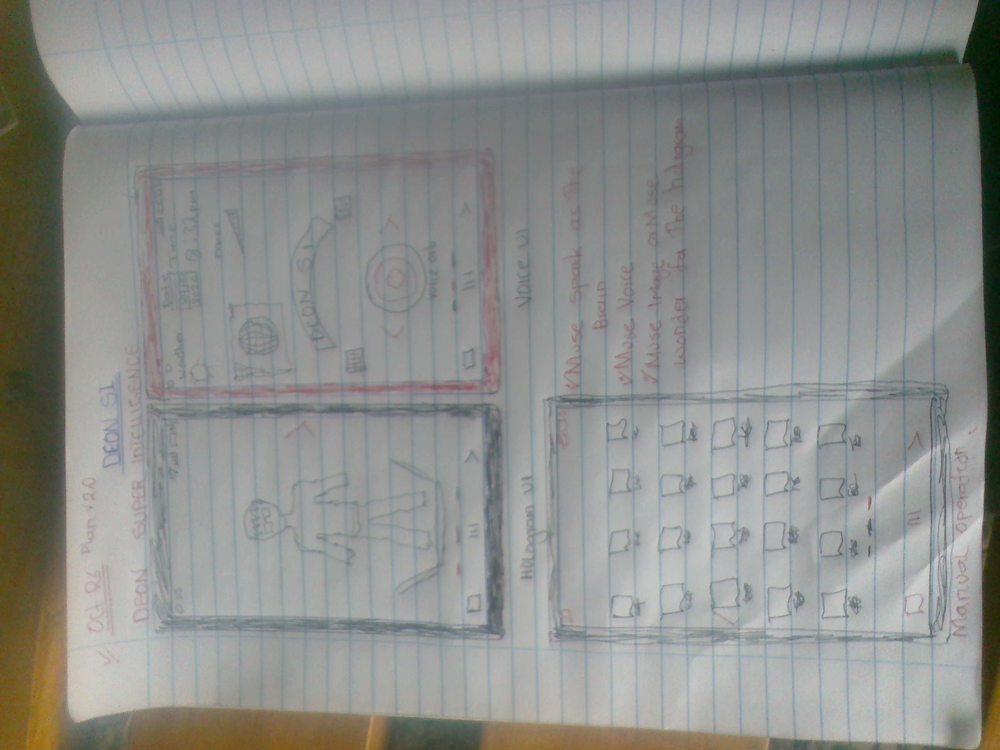

# DEON SI — Deon Super Intelligence

**One phone. Three modes. One intelligent companion.**

Deon SI is a voice-first Android launcher concept that combines everyday phone operation with an AI companion and a visual hologram-style interface. The goal is to let people use their phones naturally by voice while retaining familiar manual navigation and access to their installed apps.

> **Project status:** Concept and early prototype. Features described as planned are not claims of completed functionality. The repository is intentionally being kept documentation-only for now.

## Visual concept

The visuals below communicate the current direction of Deon SI. They are concept references, not proof that every screen or feature is already implemented.

### Three-mode app concept

### Project photo

### Concept video

<video src="https://raw.githubusercontent.com/jark-zenith/Deon-SI/main/Deon%20SI%20.mp4" controls width="100%"></video>

## The product

Deon SI brings three experiences together in one launcher:

### 1. Hologram mode
A visual 3D companion sits at the centre of the experience, with a holographic presentation, animated expressions, speech and gestures. The first version should focus on one polished character. Downloadable character packs—with their own appearance, animation, voice configuration and personality—are a potential future extension.

A character displayed on a normal phone screen is a rendered 3D avatar, not a physical free-space hologram. Physical projection hardware is outside the initial software scope.

### 2. Voice mode
A dedicated voice interface provides a central listening/speaking orb and compact information widgets. Users should be able to issue natural commands such as:

- “Hey Deon, open WhatsApp.”
- “Call Mum.”
- “Set an alarm for six.”
- “Help me plan my day.”

Actual phone actions must use supported Android APIs and respect permissions, platform restrictions and confirmation requirements. The app must never claim that an action succeeded unless it has actually been performed or verified.

### 3. Manual phone mode
A familiar home-screen launcher presents the user's installed apps—such as Phone, Camera, WhatsApp, Facebook, Settings and SIM Toolkit—so users can continue operating their phone normally. App tiles must launch real installed applications in the native Android implementation, rather than merely replying with text.

## Intelligence and internal capabilities

Deon SI is intended to use a Meta model for conversational understanding, reasoning and command routing. Voice transcription, speech output and visual assets can be integrated as separate services where appropriate.

Internal capabilities—such as Council of Minds, Aegis, Genesis Lab, Flashpoint, Nairobi Pulse, Mission Control, Babel Bridge and Timeline—should remain behind Settings or internal orchestration rather than crowding the main launcher.

The exact model, provider and service integration must be documented as they are implemented. Do not expose provider secrets in client-side code or commit API keys to the repository.

## Hackathon direction

For the Meta Global AI Developer Hackathon, the priority is a reliable end-to-end prototype that demonstrates meaningful use of Meta models and clearly distinguishes new hackathon work from earlier concept or prototype work.

Suggested MVP priorities:

1. A native Android home-screen launcher that can list and open installed apps.
2. Reliable voice command recognition and routing for a small, tested set of actions.
3. One attractive animated companion and a clear mode switcher.
4. A real Meta model integration for requests that require language understanding or reasoning.
5. Honest error states, permission handling and a short demo showing only verified features.

The project must use Meta models/tooling to meet the hackathon's model requirement; infrastructure alone is not sufficient. Keep the GitHub repository public for submission and document which functionality was created during the event.

## Technical direction

The intended direction is a responsive web UI for rapid iteration, combined with a native Android integration layer (for example, Capacitor plus purpose-built Android code) for launcher registration and supported phone actions. The final architecture should be confirmed against the requirements of the selected Android features.

A web page alone cannot replace Android's home screen, enumerate and launch all installed apps freely, or control other apps without native integration and appropriate permissions. Deeper cross-app automation is not part of the initial MVP and requires careful review of Android and Google Play policies.

## Product principles

- **Real actions over simulated confirmations.** Report success only after an action has genuinely succeeded.
- **Privacy and consent.** Request only the permissions needed for a clear feature and explain why they are needed.
- **Security.** Keep API credentials on a trusted server, never in public frontend code.
- **Accessibility and resilience.** Provide manual and text alternatives when microphone access or speech recognition is unavailable.
- **Honest status.** Clearly distinguish working features, prototypes, and future plans.
- **Focused scope.** Finish one dependable end-to-end experience before expanding the feature set.

## Current scope and limitations

This repository currently includes the README, visual concept images, and a concept video. Application source code and a working Android build are not represented as complete in this repository at this stage.

No claim is made here that the native launcher, Meta model integration, real phone actions, personalized 3D avatar, downloadable character packs, persistent memory or complete voice pipeline are already implemented.

## Repository

- GitHub: https://github.com/jark-zenith/Deon-SI
- Product name: **Deon SI**
- Expanded name: **Deon Super Intelligence**
